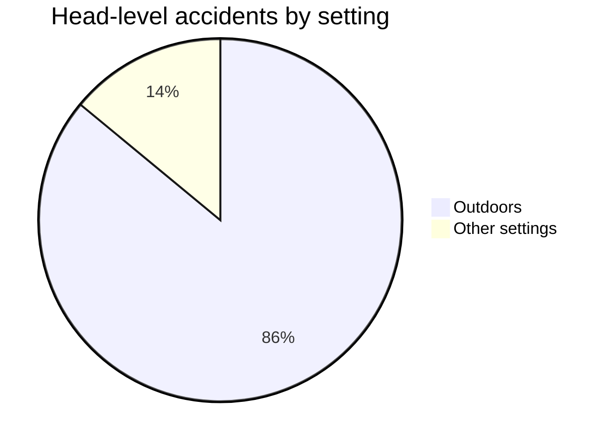
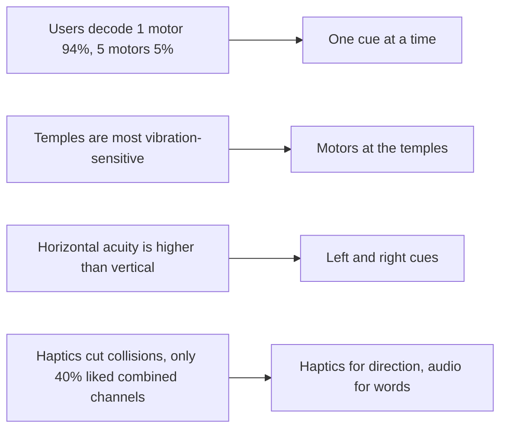
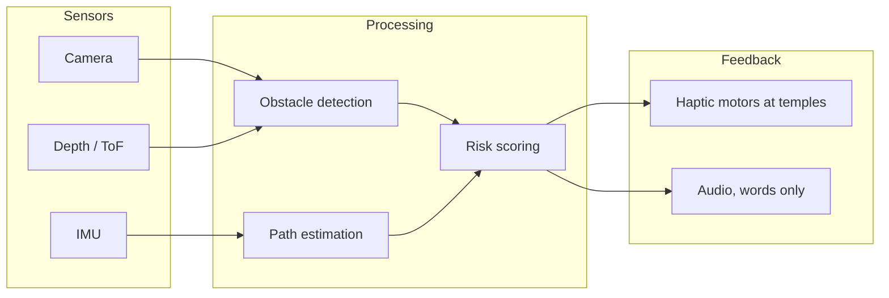
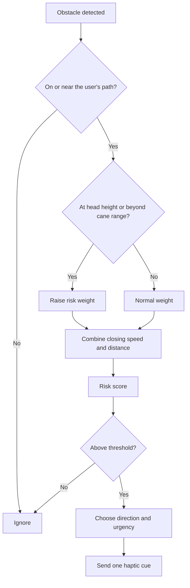
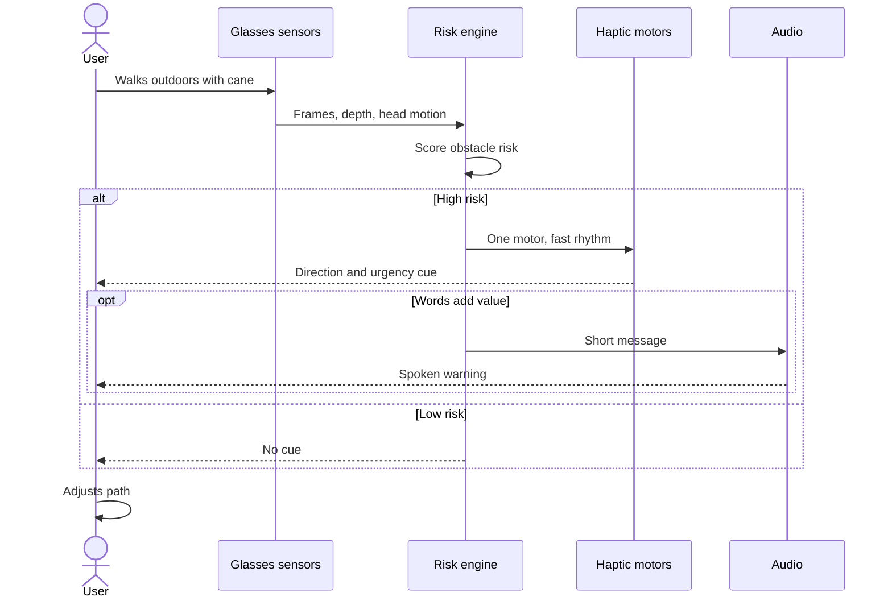
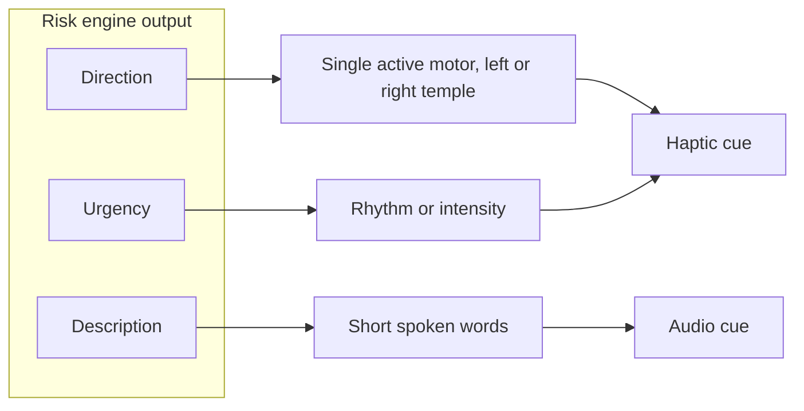
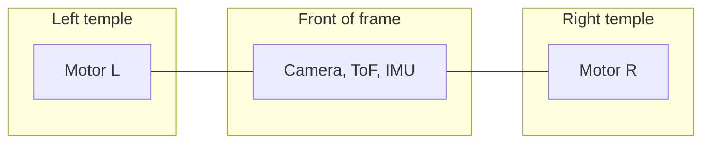

# VisionX

**Risk-aware wearable cues for blind and low-vision pedestrians.**

VisionX is a smart-glasses concept that warns users about head-level and mid-range obstacles that a white cane or guide dog does not reliably catch. It turns what the glasses sense into short, simple haptic cues, with audio reserved for words.

> **Status:** Concept and research stage. This repository documents the problem, the evidence base and the design rationale. It is not a working product.

---

## Table of Contents

1. [Problem](#problem)
2. [The Gap in Current Aids](#the-gap-in-current-aids)
3. [Concept Overview](#concept-overview)
4. [Design Principles (Evidence-Based)](#design-principles-evidence-based)
5. [Planned System Architecture](#planned-system-architecture)
6. [Feedback Design](#feedback-design)
7. [Research Summary](#research-summary)
8. [Limitations and Open Questions](#limitations-and-open-questions)
9. [Roadmap](#roadmap)
10. [References](#references)

---

## Problem

Head-level collisions are a common and under-addressed hazard for blind and low-vision travellers. The key primary source is the UC Santa Cruz survey by Manduchi and Kurniawan (307 blind or legally blind respondents).

| Finding | Result |
|---|---|
| Head-level accidents at least once a month | **13%** |
| Falls at least once a month | **7%** |
| Head-level accidents that happened outdoors | **86%** (tree branches, poles, signs, construction equipment) |
| Accidents with medical consequences (stitches, dental treatment) | **23%** |
| Respondents who lost confidence as independent travellers | **26%** |
| Frequent (more than monthly) head-level accidents: legally blind vs fully blind | **18% vs 9%** |

**Where head-level accidents happen**

Two further points shape the design:

- **Aid type did not protect against head-level hits.** Cane users and dog-guide users had similar accident rates.
- **Legally blind users were hit more often than fully blind users.** One possible explanation is that residual vision reduces caution. This is a hypothesis, not a finding of the study, and it should be tested with the target user group.

## The Gap in Current Aids

A white cane does not reliably detect obstacles at head or knee level, or beyond roughly 1 m. VisionX targets exactly this gap: **upper-body and mid-range hazards that the cane misses.** It is designed to complement the cane, not replace it.

## Concept Overview

VisionX is a pair of smart glasses that:

1. **Senses** the space ahead (camera, depth/time-of-flight, IMU).
2. **Scores risk**, not just distance. A pole 1 m away on the user's path matters more than a wall 1 m away to the side.
3. **Cues the user** through a minimal haptic vocabulary, with audio used only when words are needed.

### Concept flow

## Design Principles (Evidence-Based)

| # | Principle | Evidence |
|---|---|---|
| 1 | **One cue at a time.** Encode direction with a single motor. Encode urgency with rhythm or intensity, not extra motors. | In an EPFL head-vibration study (22 subjects), participants counted active motors correctly 94% of the time with one motor, 40% with two and 5% with five. |
| 2 | **Place motors where the head is most sensitive.** Temple and occipital regions are the most vibration-sensitive. The forehead is best for spatial discrimination. | Localization precision varies by head region. Avoid the extreme frontal and rear positions when precision matters. |
| 3 | **Respect spacing limits.** | A skin-simulant study suggests inter-tactor spacing of at least 60 mm, which is tight on a glasses frame. Motors may need to sit well apart. |
| 4 | **Favour left/right over up/down.** | Tactile acuity is higher for horizontal than vertical presentation. |
| 5 | **Haptics for direction and urgency, audio only for words.** | In a 72-participant VR study, haptic feedback significantly reduced collisions (P=.05), while audio improved trajectory smoothness. Only 40% preferred combined modalities. |
| 6 | **Keep the cane.** | Anecdotal forum feedback shows blind users worry about sensory overload and about the cost of fragile devices. |

**Benchmark for cue design:** GuideTouch reached 93.75% recognition accuracy for primary directional cues with 14 visually impaired users. VisionX uses this as the target to match or beat.

### Evidence-to-design map

## Planned System Architecture

| Component | Role |
|---|---|
| Camera | Identifies obstacle type (branch, pole, sign, construction equipment) |
| Depth / ToF sensor | Measures distance to obstacles at head height and beyond cane range |
| IMU | Tracks head motion and walking direction to estimate the user's path |
| Risk engine | Scores each obstacle by position relative to the path, closing speed and height, not distance alone |
| Haptic motors | Deliver direction and urgency cues at the temples |
| Audio output | Short spoken messages only when words add value |

### Risk scoring logic

### Interaction sequence

## Feedback Design

| Information | Channel | Encoding |
|---|---|---|
| Direction (left / right) | Haptic | Single active motor |
| Urgency | Haptic | Rhythm or intensity, never extra motors |
| Descriptive information (for example, "construction ahead") | Audio | Short spoken words |

### Cue mapping

### Motor placement concept

Motors sit at the temples, ideally at least 60 mm apart, with sensors at the front of the frame.

## Research Summary

- **The need is real.** Head-level accidents are frequent, mostly outdoor, and carry medical and confidence costs.
- **Existing aids leave a gap.** Cane and dog guide users are equally exposed.
- **The feedback evidence is consistent.** Users decode one simple cue far better than several at once, and most prefer a single channel.
- **The form factor is constrained.** Motor spacing and head sensitivity limit what a glasses frame can do.

## Limitations and Open Questions

- The motor-spacing guideline (60 mm or more) conflicts with the size of a glasses frame. Real placement needs prototyping and user testing.
- The haptic vs audio findings come from a VR study and may not transfer directly to real streets.
- The forum evidence on overload and cost is anecdotal and comes from a few voices. It is context, not data.
- The "residual vision lowers caution" explanation is untested.
- A neuro-interface extension (such as TMS) is highly speculative and is out of scope for any near-term prototype.

## Roadmap

- [x] Problem framing and evidence review
- [x] Design principles from haptic and usability research
- [ ] Define the risk-scoring model
- [ ] Prototype motor layout on a glasses frame
- [ ] Cue recognition test with visually impaired users (target: at or above 93.75%)
- [ ] Outdoor field testing alongside cane use

## References

1. Manduchi, R. and Kurniawan, S. *Mobility-Related Accidents Experienced by People with Visual Impairment*. UC Santa Cruz Technical Report UCSC-SOE-10-24. https://tr.soe.ucsc.edu/sites/default/files/technical-reports/UCSC-SOE-10-24.pdf
2. *International Journal of Design* article on white cane limits. https://ijdesign.org/index.php/IJDesign/article/view/1209/559
3. EPFL / NCCR Robotics, tactile communication and head-vibration study. https://dev.nccr-robotics.ch/tag/tactile-communication
4. Vibrotactile localization on the head. https://arxiv.org/pdf/2201.03036
5. Tactor spacing study (CMU Robotics Institute). https://ri.cmu.edu/?p=113053
6. Tactile acuity by orientation. https://opinvisindi.is/items/b386e0a7-8c77-42bd-b71c-26326eb66963/full
7. GuideTouch. https://arxiv.org/html/2601.13813v2
8. Haptic vs audio feedback in VR navigation (JMIR Rehabilitation, 2024). https://rehab.jmir.org/2024/1/e55776/PDF
9. AppleVis forum discussion (anecdotal). https://applevis.com/comment/171387 and https://applevis.com/comment/171391

## License

To be decided. Add a `LICENSE` file before publishing.
